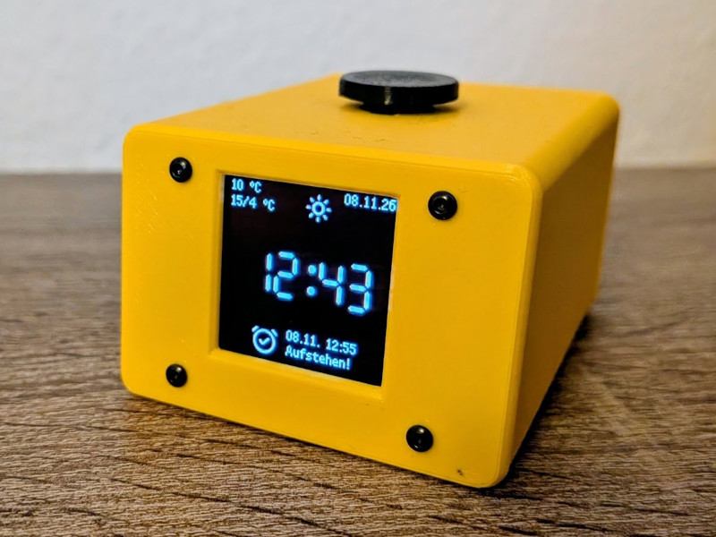

# Weck Mich Am Tag

<div align="center">
  <span style="display: flex; align-items: center; justify-content: center; padding: 20px; box-sizing: border-box;">
    
  </span>
</div>

A WiFi- and MQTT-controlled bedside alarm clock for the Raspberry Pi Pico W, written in
MicroPython. Everything that does not have to happen on the device itself is done over MQTT:
adding and removing alarms, pushing weather data, reading the current state and remote-controlling
the clock.

## Features

- Setup portal on first boot (WiFi + MQTT + time configuration, no flashing of credentials needed)
- Alarms stored on the device (`config.json`), manageable over MQTT
- Date alarms with custom names and ringtones (built-in melodies or RTTTL strings)
- Snooze, ring timeout and a gradually increasing volume
- NTP time sync with automatic EU summer/winter time handling
- Weather display (current conditions and today's forecast) fed via MQTT
- State machine with `standby`, `info`, `night`, `calm` and alarm states
- Automatic ignoring of the next alarm after you got up shortly before it would ring
- Availability (Last Will) topic, state topic, event topic and control topic
- Factory reset by holding the BOOTSEL button

## Setup

Flash MicroPython onto the Pico W and copy the contents of `src/` to the root of the device -
either with the MicroPico extension (upload, see [Development setup](#development-setup)) or
manually with [`mpremote`](https://docs.micropython.org/en/latest/reference/mpremote.html). The
layout on the device then mirrors `src/`: `main.py`, the other modules, `lib/` (the bundled
`ssd1351` and `umqtt` drivers), `fonts/` and `icons/` all sit at the file system root. Everything
in `src/` is needed at runtime.

On boot, `main.py` looks for `config.json`. If it does not exist, the clock starts in setup mode.

### Configure network

#### Landing page

Without a `config.json` the Pico starts a WiFi access point and a small web server:

1. Connect to the access point **WMATConfig** with the password **wmat**
   (IP address `192.168.4.1`).
2. Open **http://192.168.4.1** in a browser. The landing page shows a form with the sections
   *WiFi Configuration*, *MQTT Configuration* and *Time Configuration*.
3. Press **Save and Restart**. The values are written to `config.json` and the device reboots
   into normal operation.

#### WiFi setup

| Field         | Default   | Description                                              |
| ------------- | --------- | -------------------------------------------------------- |
| SSID | -    | The SSID of your WiFi |
| Password    | - | The password of your WiFi |

The clock retries the connection every 5 seconds
until it is online and keeps reconnecting on its own if the network drops.
The onboard LED stays on while starting up until WiFi, MQTT and the NTP time sync are all up.
After that it only reflects the WiFi and MQTT connection: it lights up again if either drops.

#### MQTT setup

| Field         | Default   | Description                                              |
| ------------- | --------- | -------------------------------------------------------- |
| Server        | -         | Hostname or IP of the MQTT broker                        |
| Port          | `1883`    | Broker port                                              |
| User          | -         | Broker user (optional)                                   |
| Password      | -         | Broker password (optional)                               |
| Topic-Prefix  | `wmat  `  | Prefix for every topic of this device                    |

The clock retries the broker connection every 5 seconds until it is online and keeps
reconnecting on its own if the connection drops.

All topics are built as `<topic_prefix> + suffix`:

| Suffix            | Direction | Description                              |
| ----------------- | --------- | ---------------------------------------- |
| `/available`      | published | Availability / Last Will                 |
| `/alarms`         | published | Current list of alarms                   |
| `/alarm/add`      | subscribed| Add (or overwrite) an alarm              |
| `/alarm/remove`   | subscribed| Remove an alarm                          |
| `/state`          | published | Current state of the clock               |
| `/event`          | published | Button events                            |
| `/control`        | subscribed| Remote control                           |
| `/weather`        | subscribed| Weather data                             |
| `/test/in`        | subscribed| Debug input, echoed to `/test/out`       |
| `/test/out`       | published | Debug output                             |

#### Time setup

| Field         | Default   | Description                                              |
| ------------- | --------- | -------------------------------------------------------- |
| Winter TZ Offset | `1`    | UTC offset in hours for winter time (summer = offset + 1)|
| NTP Server    | `pool.ntp.org` | Server used for time sync (every 6 hours)           |

### Factory reset

Hold the **BOOTSEL** button on the Pico for **10 seconds** (the onboard LED lights up while
pressed). The `config.json` is deleted and the clock restarts into setup mode, i.e. the access
point and the landing page appear again.

### Alarms

Alarms are stored in `config.json` under the key `alarms` and are managed via MQTT.

#### How to add alarms

Publish a JSON object to `<prefix>/alarm/add`:

```json
{"year": 2026, "month": 12, "day": 24, "hour": 8, "minute": 0, "sound": "CalmRise"}
```

If an alarm with the same identity already exists, it is **overwritten** instead of duplicated.
Identity ignores `sound` and `name`, so re-adding the same time with a different ringtone updates
the existing alarm.

There is no repeating weekday alarm. To wake up on a schedule, let your home automation publish the
next days as individual alarms, e.g. every afternoon. Re-sending the same alarms is safe, so
the refill can be as simple or as frequent as you like.

#### How to delete alarms

Publish the same JSON object to `<prefix>/alarm/remove`. It must match an existing alarm
**exactly**: in contrast to adding, `sound` and `name` are part of the match here. An alarm that
carries a ringtone or a label can therefore only be removed by sending that ringtone and that
label back unchanged. A payload that does not match is logged as `Alarm not found` and nothing is
deleted.

Additionally, an alarm is deleted automatically once its date has passed, whether it rang
or not.

The current alarm list is published as a JSON array to `<prefix>/alarms` whenever it changes and
every 10 minutes. Alarms that are currently suppressed carry an extra `"ignored": true` flag:

```json
[{"year": 2026, "month": 12, "day": 24, "hour": 8, "minute": 0, "ignored": true}]
```

#### Alarm properties

| Property   | Type   | Description                                        |
| ---------- | ------ | -------------------------------------------------- |
| `hour`     | 0-23   | Hour of the alarm                                  |
| `minute`   | 0-59   | Minute of the alarm                                |
| `year`     | ≥ 2026 | Year of the alarm                                  |
| `month`    | 1-12   | Month of the alarm                                 |
| `day`      | 1-31   | Day of the alarm                                   |
| `name`     | string | Optional label, shown next to the next alarm on the info screen |
| `sound`    | string | Optional ringtone, see below                       |

Behaviour:

- An alarm rings for a maximum of **5 minutes**, then it times out and stops.
- **Snooze** pauses the alarm for **5 minutes**, after which it rings again.
- The volume increases stepwise while the alarm is ringing.
- Alarms are only triggered in states where alarms are allowed (not in `calm`).
- If you switch from night mode to day mode and the next alarm is less than **45 minutes** away,
  it is automatically ignored (and re-enabled the next time you go to sleep).

**Custom ringtones:** the `sound` value is either the name of a built-in melody
(`Default`, `HappyWake`, `CalmRise`) or a full **RTTTL** string:

```json
{"year": 2026, "month": 3, "day": 4, "hour": 6, "minute": 30, "sound": "CalmRise:d=4,o=5,b=55:d,f#,a,f#,d,e,g,e,d,a,b,a,g,e,d,f#,a,d6,a,f#,e,g,e,d,f#,a,g,e,d"}
```

Any RTTTL melody works, so you are not limited to the built-ins. A collection of
ready-made melodies is listed at <https://lhlab.wiki/wiki/RTTTL_Songs> - paste the RTTTL string
of the one you want into `sound`. The format is `name:d=<duration>,o=<octave>,b=<bpm>:<notes>`,
where a note is an optional note length (`1`, `2`, `4`, `8`, `16`, `32`, `64`), a pitch
(`a`-`g`, optionally `#`, `h` = B natural), an optional octave (`4`-`7`) and an optional
dot for a dotted note; `p` is a pause.

Unknown names or invalid RTTTL fall back to `Default`.

### Weather data

Weather is pushed to the clock as JSON on `<prefix>/weather` (there is no polling on the device):

```json
{
  "unit": "C",
  "current": {
    "temp": 22,
    "condition": 0,
    "isDay": true
  },
  "forecast": {
    "temp1": 18,
    "temp2": 27
  }
}
```

- `unit`: `C` or `F` (anything containing `c`/`f` is detected case-insensitively, default `C`)
- `current.temp`: current temperature
- `current.condition`: weather condition code from the **WMO World Weather Interpretation codes
  (WW)**, the same numeric codes used by e.g.
  [Open-Meteo](https://open-meteo.com/en/docs) (`weather_code` in `current`). Only
  the numeric value is expected - the mapping to an icon happens on the device.
  Codes covered by the icons: `0`-`3` clear to overcast, `45`/`48` fog, `51`-`67` and `80`-`82`
  rain, `71`-`77`/`85`/`86` snow, `95`/`96`/`99` thunderstorm. Everything else (e.g. `97`) uses a
  fallback icon.
- `current.isDay`: selects the day or night variant of the icon
- `forecast.temp1` / `forecast.temp2`: two temperatures that are shown as forecast. You can e.g.
  show the maximum of the current day as `temp1` and minimum of the coming night as `temp2`
  between 6 am to 6 pm. And between 6 pm and 6 am you can show the minimum of the current night
  as `temp1` and the maximum of the next day as `temp2`. The data has to be provided like that
  by your home automation.

The condition code is mapped to a pre-rendered icon (day/night × warm white/dark red) and shown
together with the current temperature on the display.

### State, events and control

#### Availability topic

- On a successful connect the clock publishes `true` (retained) to `<prefix>/available`.
- A Last Will publishes `false` (not retained) if the connection to the broker is lost,
  so a broker or home automation can see when the clock goes offline.

#### State topic

`<prefix>/state` (published) carries the current state of the state machine as a plain string.
It is published on every state change and once per minute:

| State           | Meaning                                                     |
| --------------- | ----------------------------------------------------------- |
| `standby`       | Clock shown in a small font at a random position (moves every update to reduce burn-in) |
| `info`          | Info screen (time, date, weather, next alarm), auto-return to `standby` after 60 seconds |
| `night`         | Night mode (display off)                                    |
| `night_info`    | Night mode with the display on for 15 seconds               |
| `alarm_ringing` | An alarm is ringing                                         |
| `alarm_snooze`  | The ringing alarm is snoozed                                |
| `calm`          | Display off, alarms disabled, slowed-down main loop, can be set if noone is at home |

For completeness these are the internal states that cannot be published:

| State           | Meaning                                                     |
| --------------- | ----------------------------------------------------------- |
| `setup`         | Reserved for the configuration portal (the portal runs before the state machine starts) |
| `boot`          | First state before `init`                                   |
| `init`          | Initializing, waiting for WiFi, MQTT and NTP                |

#### Event topic

`<prefix>/event` (published) reports button events:

| Event         | Trigger                                     |
| ------------- | ------------------------------------------- |
| `single_click`| Short press                                 |
| `double_click`| Two presses                                 |
| `triple_click`| Three presses                               |
| `long_press`  | Press held ≥ 1.8 seconds                    |
| `release`     | Published right after every button event    |

What a press does depends on the current state:

- **single click**: `standby` ⇄ `info`, `night` ⇄ `night_info`, snooze while ringing
- **long press**: stop a ringing or snoozed alarm, `standby`/`info` → `night_info`
  (display on for 15 s, then `night`), `night` → `info`
- **double/triple click**: currently only published as events, no action is bound to them

#### Control topic

`<prefix>/control` (subscribed) accepts three kinds of payloads:

1. **Button events** - the same strings as on the event topic
   (`single_click`, `double_click`, `triple_click`, `long_press`, `release`), which are handled
   exactly like a physical button press.
2. **`stop_alarm`** - stops a ringing alarm.
3. **`enter_state_<state>`** - forces a state change, e.g. `enter_state_calm`,
   `enter_state_night`, `enter_state_info`. Only states known to the state machine are accepted.

Everything published to `<prefix>/test/in` is echoed back to `<prefix>/test/out` for debugging.

## Development setup

Development is done in **VS Code** (VSCodium works as well) with the **MicroPico** extension
installed. The recommended extensions are:

- `ms-python.python`
- `ms-python.black-formatter`
- `detachhead.basedpyright` (the type checker - a Pyright fork with stricter defaults and Pylance-style features)
- `paulober.pico-w-go` (the MicroPico extension)

The file `.micropico` in the repository root marks this folder as a Pico project, so the
extension activates on start (`micropico.openOnStart: true`).

### Upload / sync

The relevant settings live in `.vscode/settings.json`:

| Setting                      | Value   | Meaning                                                        |
| ---------------------------- | ------- | -------------------------------------------------------------- |
| `micropico.syncFolder`       | `src`   | Only the `src/` folder is uploaded - it is mirrored to the root of the Pico's file system, so `src/main.py` becomes `/main.py` and `src/lib` becomes `/lib` |
| `micropico.syncAllFileTypes` | `true`  | Not only `.py` files, but also `fonts/`, `icons/`, etc. are uploaded |
| `micropico.openOnStart`      | `true`  | Auto-connect when the project is opened                        |

`README.md`, `tools/`, `typings/`, `.vscode/` and the rest of the repository stay on your
machine and never reach the device. Everything the MicroPico extension offers (upload, run,
REPL, soft/hard reset, sync) is available from the command palette and the status bar.

### MicroPython stubs

The MicroPython stubs (type information for modules such as `machine`, `network`, `rp2`, `ujson`
or `framebuf`) are not part of this repository - they can be
installed with **Extra > Switch stubs** (`micropico.extra.switchStubs`) from the command palette,
which also lets you pick the board and the stub version.

`typings/` is **gitignored** and is a symlink to the stubs folder (`~/.micropico-stubs/included`,
next to it the board-specific folder), so the type checker can resolve the MicroPython modules
as well.

BasedPyright is configured via `pyrightconfig.json`.

### Icon tooling

`tools/` contains the development-only helpers used to generate the pre-rendered
`.raw` sprite files in `src/icons/` (`iconify_to_raw.sh` plus `img2rgb565.py`, which needs
Pillow). Generated `.png`, `.svg` and `.raw` files inside `tools/` are gitignored. The icons are loaded from https://iconify.design

## Bill of materials

| Qty | Part | Notes |
| --- | ---- | ----- |
| 1 | Raspberry Pi Pico W | Runs MicroPython, connects to WiFi |
| 1 | Waveshare 1.5" 128×128 OLED RGB Display Module | SSD1351 controller, SPI |
| 1 | Passive piezo buzzer, e.g. AZDelivery KY-006 | Passive type (not the active beeper variant), driven with PWM |
| 1 | Momentary push button (single "mouse button" switch, e.g. type M03-03) | Normally open, connected between GPIO 10 and GND |
| 1-2 | Spring | 0.4 * 10 * 25 mm |
| 4 | Screws and nuts | M2 x 8 |
| - | Filament | To print the housing, PETG recommended |
| - | Cables | To connect the parts |

Optionally a small breadboard or perfboard plus a few jumper wires to wire everything up.

The printed housing for these parts is generated with OpenSCAD from [`enclosure/`](enclosure/).
See [`enclosure/BUILD.md`](enclosure/BUILD.md) for printing and assembly.

## Pinout

| Component              | Connection                                             |
| ---------------------- | ------------------------------------------------------ |
| Raspberry Pi Pico W    | MicroPython firmware                                   |
| SSD1351 OLED 128×128   | SPI0: SCK = GPIO 18, MOSI = GPIO 19, DC = GPIO 20, CS = GPIO 17, RST = GPIO 21 |
| Button                 | GPIO 10 (internal pull-up), other side to GND          |
| Buzzer                 | GPIO 14 (PWM)                                          |

## License

This project is licensed under the [GNU GENERAL PUBLIC LICENSE](LICENSE).

## Additional software used

Details and licenses are available in [Third Party Notes](THIRD_PARTY_NOTES).

### Fonts

This project includes a font derived from Liberation Mono ([Open Font License](https://openfontlicense.org/)).
- https://github.com/liberationfonts/liberation-fonts

This project includes a font derived from E1234 ([Open Font License](https://openfontlicense.org/)):
- https://ggbot.itch.io/e1234-font

Fonts were converted with [GLCD Font Creator](https://www.mikroe.com/glcd-font-creator).

### Icons

This project includes components from material-symbols-light icons ([Apache 2.0 License](https://www.apache.org/licenses/LICENSE-2.0)):
- https://icon-sets.iconify.design/material-symbols-light/

This project includes components from wi icons ([Open Font License](https://openfontlicense.org/)):
- https://icon-sets.iconify.design/wi/

### Libraries

This project includes components from micropython-lib ([MIT License](https://opensource.org/license/mit)):
- https://github.com/micropython/micropython-lib
- https://github.com/micropython/micropython-lib/blob/master/micropython/umqtt.simple/umqtt/simple.py

This project includes components from micropython-ssd1351 ([MIT License](https://opensource.org/license/mit)):
- https://github.com/rdagger/micropython-ssd1351


## AI usage

This project was written with the help of AI coding assistants. The author reviews and
understands the code - nothing was committed without being read and verified on the device.